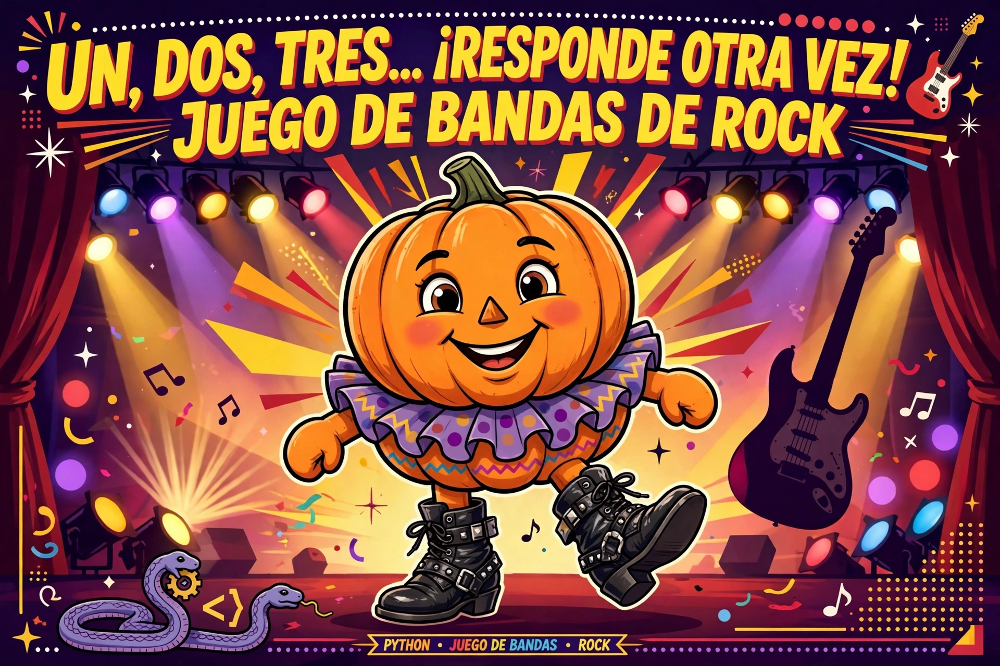

# 🎸 UN, DOS, TRES… ¡RESPONDE OTRA VEZ!
## Juego de adivinar bandas de rock

### 📝 Descripción
Es un juego interactivo hecho en Python, inspirado en el famoso programa "Un, dos, tres… responda otra vez".
Te aparece una pista:
✅ El año en el que se formó la banda
✅ El nombre del cantante principal
¡Y tú tienes que adivinar cuál es la banda de rock correcta! 🤘

### 📁 Archivos del proyecto
- `main.py` → Archivo principal, ejecutas este para iniciar el juego
- `juego.py` → Toda la lógica de las rondas, pistas y puntuación
- `bandas.py` → Lista con los datos de todas las bandas (nombre, año, cantante)
- `colores.py` → Colores para que el texto de la terminal se vea más bonito

### ▶️ Cómo ejecutar el juego
1. Abre la terminal y entra a la carpeta `Rockleyendas`
2. Escribe el comando:
```bash
python main.py
